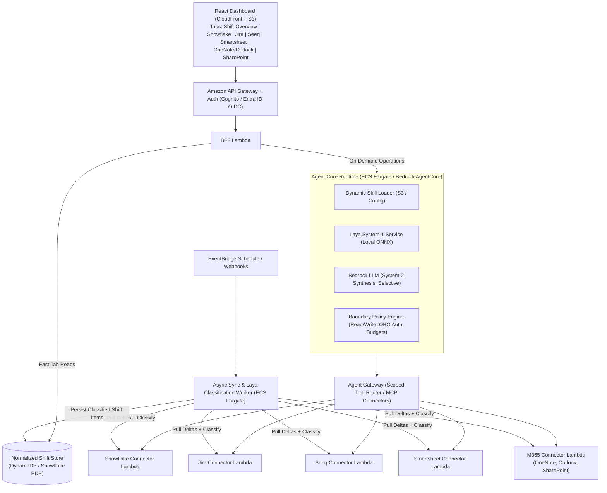

# Proposed AWS Solution: Multi-Source Support Shift Dashboard

## 1. Executive Summary

This document outlines the proposed AWS architecture for a **Support Shift Operations Dashboard** that aggregates structured, time-series, and unstructured operational data across **Snowflake, Jira, Seeq, Smartsheet, SharePoint, OneNote, and Outlook**.

For incoming support shift engineers, the dashboard surfaces four primary operational views—**Daily Call**, **Completed**, **Pending**, and **Risk Items**—alongside source-specific tabs and on-demand operations over **OneNote**, **Outlook**, and **Seeq**.

To keep the solution secure, fast, and cost-efficient at scale, the architecture separates **deterministic dashboard reads** from **agentic operations**, enforces **Dynamic Skills**, **Dynamic Tooling**, and **hard Agent Boundaries**, and pairs **Laya (System 1 local classification)** with **Amazon Bedrock LLMs (System 2 synthesis)** only where generative reasoning is needed.

---

## 2. End-to-End AWS Architecture



### Request Flows

1. **Fast Dashboard Tab Navigation (Deterministic Path):**
   - `React UI Tab Click -> API Gateway -> BFF Lambda -> DynamoDB / Snowflake`
   - Reads pre-classified, normalized shift items (`daily_call`, `completed`, `pending`, `risk`) with **zero LLM or AI inference at click time**.
2. **On-Demand Operations (Agentic Path):**
   - `React UI Action ("Summarize Shift", "Analyze Seeq Excursion", "Draft OneNote Update") -> API Gateway -> BFF Lambda -> Agent Core Runtime -> Agent Gateway -> Connector Lambdas`
   - Loads only the matching **Dynamic Skill**, binds only that skill's **Scoped Tools**, enforces **Agent Boundaries**, and returns either a structured result or an approval card for write actions.
3. **Background Sync & Pre-Classification Pipeline:**
   - `EventBridge -> ECS Fargate Worker (with Laya)` pulls incremental updates from Jira, Outlook, OneNote, SharePoint, Smartsheet, and Seeq, classifies them locally with `laya.systemOne()`, and persists structured outputs into the shift store.

---

## 3. Core Agentic Design Pillars

### A. Dynamic Skills (On-Demand Playbooks)

Rather than maintaining one monolithic system prompt for 7+ data sources, store modular **Skill Packs** (Markdown/YAML + JSON output schemas) in S3 or versioned config. Only the skill matching the user's operation is loaded into `Agent Core Runtime`:

| Skill ID | Purpose | Bound Tools | Output / Action |
| --- | --- | --- | --- |
| `shift-handover-brief` | Compile incoming shift brief across all sources | `read_shift_store`, `outlook_get_calendar_calls`, `onenote_get_shift_pages` | Structured `Daily Call`, `Completed`, `Pending`, `Risk` summary |
| `m365-notes-ops` | Extract action items & risk signals from Outlook/OneNote/SharePoint | `outlook_list_shift_emails`, `onenote_get_shift_pages`, `sharepoint_search_runbooks`, `onenote_append_handover_summary` *(gated)* | Action items + optional OneNote draft |
| `seeq-excursion-ops` | Inspect active Seeq signals/capsules & link to incidents | `seeq_list_capsules`, `seeq_get_signal_stats`, `jira_get_issues`, `seeq_add_capsule_note` *(gated)* | Excursion severity + root-cause context |
| `jira-snowflake-triage` | Classify synced Jira comments & warehouse KPIs | `snowflake_query_report`, `jira_get_issues` | Categorized tickets + escalation flags |

---

### B. Dynamic Tooling (Agent Gateway + Scoped Binding)

Each external system is isolated behind a dedicated **Datasource Connector Lambda** registered in **Agent Gateway** using a uniform tool schema (OpenAPI / MCP):

| Connector Lambda | Read Tools (Auto-Allowed) | Write / Operation Tools (Approval-Gated) |
| --- | --- | --- |
| **Snowflake** | `snowflake_query_report` | *(read-only)* |
| **Jira** | `jira_get_issues`, `jira_get_comments` | `jira_add_comment`, `jira_update_status` |
| **Seeq** | `seeq_list_capsules`, `seeq_get_signal_stats` | `seeq_add_capsule_note` |
| **Smartsheet** | `smartsheet_get_rows` | `smartsheet_update_row` |
| **M365 (Outlook / OneNote / SharePoint)** | `outlook_list_shift_emails`, `outlook_get_calendar_calls`, `onenote_get_shift_pages`, `sharepoint_search_runbooks` | `outlook_create_draft`, `outlook_send_shift_email`, `onenote_append_handover_summary` |

**Scoped Binding Rule:** When executing `seeq-excursion-ops`, the Agent Gateway exposes *only* the Seeq and Jira read tools (plus the gated Seeq note tool) to the runtime. Unrelated tools (e.g., `outlook_send_shift_email`) are excluded from the execution context altogether.

---

### C. Agent Boundaries (Enforced in Code & IAM)

Boundaries are enforced by the **Runtime Policy Engine** and **AWS IAM**, independent of model prompts:

1. **Read vs. Write Isolation (Human-in-the-Loop):**
   - Read, classify, and summarize operations execute automatically.
   - Any state-mutating tool (`outlook_send_shift_email`, `onenote_append_handover_summary`, `jira_add_comment`, `seeq_add_capsule_note`) is blocked from direct execution and returns a **`pending_approval`** payload to the React UI. The engineer reviews the diff/draft and clicks **Approve** before the write connector runs.
2. **Identity & Data Access Boundary (On-Behalf-Of):**
   - User identity from Cognito / Entra ID OIDC is propagated to M365, Jira, and Smartsheet connectors so an engineer never sees restricted Outlook emails, private OneNote sections, or unauthorized SharePoint sites.
3. **Execution & Fault-Tolerance Boundary:**
   - Hard cap on tool calls per request (e.g., max `6` tool calls) and strict per-connector timeouts (e.g., `20s`).
   - Partial degradation: if one connector (e.g., Smartsheet or Seeq) times out, the remaining tabs and shift items still render with a source-status indicator.
4. **Confidence Boundary (Laya Gating):**
   - Automated classifications below the confidence threshold (e.g., `answer_confidence < 0.75`) are flagged `needs_review: true` in the dashboard instead of being silently treated as finalized.

---

## 4. Normalized Shift Item Data Model

All sources map into a common **Shift Item** schema in DynamoDB / Snowflake so the **Shift Overview** tab can filter and group uniformly while preserving links back to each native tool:

```json
{
  "item_id": "seeq:capsule-8421",
  "source": "seeq",
  "bucket": "risk",
  "title": "Reactor-B temperature excursion above threshold for 18m",
  "owner": "Shift-A On-Call",
  "category": "process_excursion",
  "priority_score": 2.68,
  "escalation_risk": 0.87,
  "confidence": 0.91,
  "needs_review": false,
  "metadata": {
    "asset": "Reactor-B",
    "linked_jira": "SUP-1482"
  },
  "deep_link": "https://seeq.internal.example/workbook/...",
  "updated_at": "2026-11-25T08:40:00Z"
}
```

### Dashboard Tab Mapping

- **Shift Overview Tab:** Aggregates across all sources by `bucket`:
  - **Daily Call:** Scheduled Outlook call agenda + high-priority handover items.
  - **Completed:** Items resolved during the outgoing shift.
  - **Pending:** Active tasks/tickets handed off to the incoming shift.
  - **Risk Items:** Items where `bucket = "risk"` or `escalation_risk >= 0.5` (Seeq excursions, SLA-risk Jira comments, urgent Outlook threads).
- **Source Tabs (`Snowflake`, `Jira`, `Seeq`, `Smartsheet`, `SharePoint`, `OneNote/Outlook`):** Display source-native records enriched with Laya's `bucket`, `priority_score`, `escalation_risk`, and `needs_review` badges.

---

## 5. Hybrid AI Strategy: Laya (System 1) + Bedrock LLM (System 2)

| Workload | Engine | Why |
| --- | --- | --- |
| Classify Jira comments, Outlook emails, OneNote bullets into `daily_call` / `completed` / `pending` / `risk` | **Laya (`@receptron/laya`)** | Runs inside VPC via ONNX Runtime; **\$0/token**, calibrated probabilities, guaranteed structured schema. |
| Score frustration, urgency, and escalation risk | **Laya (`@receptron/laya`)** | Evaluates multiple questions in a single forward pass; persists results in DB for instant UI reads. |
| Summarize multi-email Outlook threads + OneNote pages into a **Daily Call Brief** | **Amazon Bedrock LLM** | Generative synthesis is required for human-readable shift narratives. |
| Cross-source reasoning on complex **Seeq** anomalies + **SharePoint** runbooks, or `needs_review` items | **Amazon Bedrock LLM** | Reserved for the ~15–30% complex/low-confidence cases rather than 100% of records. |
| UI tab navigation & structured filtering | **Deterministic BFF + DB** | Zero AI latency or cost for standard SQL/DynamoDB queries. |

---

## 6. Phased AWS Implementation Plan

1. **Phase 1 — Unified Data Store & Laya Batch Classification**
   - Deploy normalized shift table (DynamoDB / Snowflake) and EventBridge-triggered ECS Fargate worker running `@receptron/laya` to classify synced Jira, Outlook, OneNote, Smartsheet, and Seeq items.
   - Expose read-only tabs via API Gateway + BFF Lambda.
2. **Phase 2 — Agent Core Runtime, Dynamic Skills & Read-Only Tools**
   - Stand up `Agent Core Runtime` + `Agent Gateway` with `shift-handover-brief`, `m365-notes-ops`, and `seeq-excursion-ops` skills.
   - Connect read-only Connector Lambdas and Bedrock LLM for on-demand shift briefings and Seeq excursion summaries.
3. **Phase 3 — Gated Write Operations & Audit Trail**
   - Enable write tools (`outlook_send_shift_email`, `onenote_append_handover_summary`, `jira_add_comment`, `seeq_add_capsule_note`) behind the UI human-approval boundary with CloudTrail / DynamoDB audit logging.

---

## 7. Local Proof of Concept in This Repository

This repository includes a working local implementation of the **Phase 1 classification & persistence pattern** using Node.js (`node:sqlite` + `@receptron/laya`) in place of cloud Snowflake/DynamoDB:

- [`src/db.ts`](src/db.ts) — Local SQLite datastore (`jira_tickets` + `jira_classifications`) and typed Laya questions (`category`, `customer_frustration`, `escalation_risk`).
- [`src/server.ts`](src/server.ts) — Backend API (`GET /api/tickets`, `POST /api/tickets/classify`) and confidence gating (`needs_review`).
- [`src/jira-sample.ts`](src/jira-sample.ts) — Standalone script demonstrating `SQLite -> Laya.systemOne() -> Structured Response + Persistence`.
